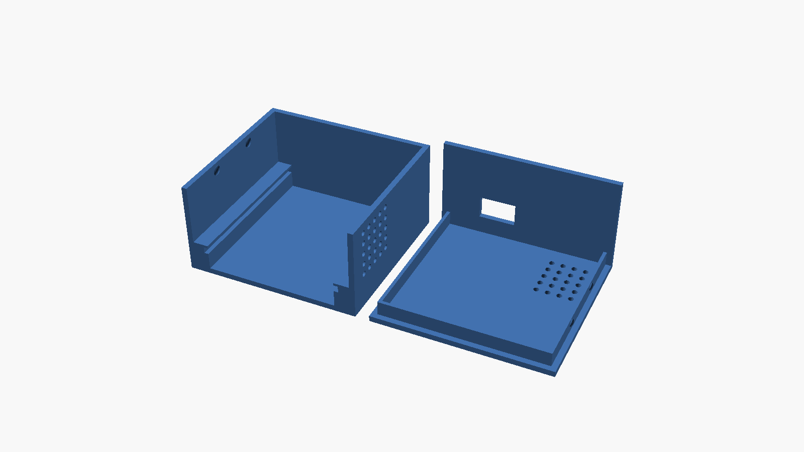
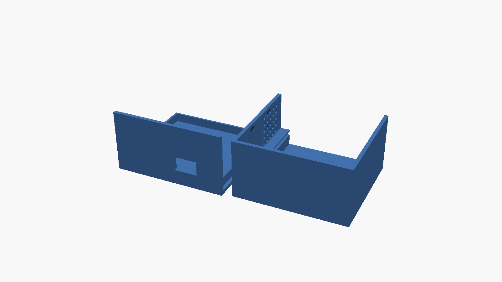
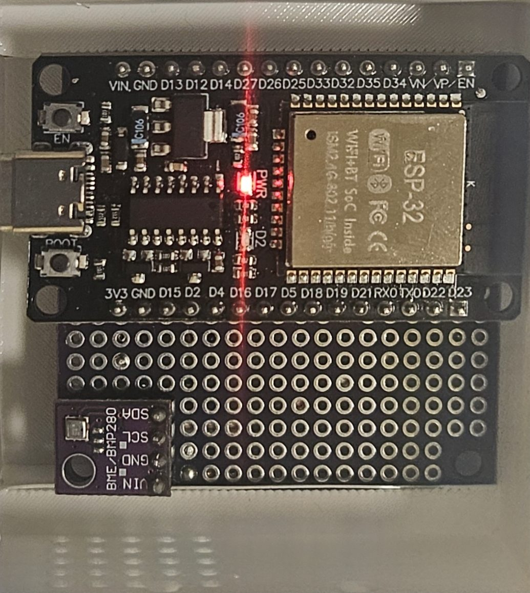

# Weather Station — 3D-printed case

A two-part snap-together enclosure for the prototype: an ESP32 DevKit V1
soldered to a **50 × 50 mm perfboard** with a BME280/BMP280 breakout on the
same board. Both model files in this folder are already exported at **101 %**
— print them at 100 % in your slicer, do **not** scale again.





## Files

| File          | What it is                                                    |
| ------------- | ------------------------------------------------------------- |
| `ws-case.3mf` | Bambu Studio project — plate, profile and the 101 % transform |
| `ws-case.stl` | Plain mesh with the 101 % scale baked into the vertices       |
| `images/`     | Renders of the model and a photo of the assembled prototype   |

The 3MF was saved from Bambu Studio 2.08 for a **Bambu Lab A1, 0.4 mm nozzle,
0.2 mm layers**. Any FDM printer will do with the STL.

### Why 101 %

The perfboard is a tight fit in the body's rail. At 100 % the board binds on
the rail and the lid wall does not seat over the body; at 101 % the board
slides in with light thumb pressure and the lid closes flush. The scale is
applied uniformly, so wall thickness and hole sizes grow by the same 1 %.

## Dimensions (as exported, 101 %)

| Part                                | W × D × H (mm)      |
| ----------------------------------- | ------------------- |
| Body (three walls, floor, rail)     | 63.4 × 59.4 × 32.9  |
| Lid (top plate + fourth wall)       | 63.4 × 61.4 × 34.9  |
| Both parts as laid out on the plate | 131.9 × 61.4 × 34.9 |

Inner clearance suits a 50 × 50 mm perfboard with the ESP32 DevKit V1
(≈ 51 × 28 mm) mounted on it and a 4-pin BME280/BMP280 breakout beside it.

## Print settings

| Setting      | Value                                             |
| ------------ | ------------------------------------------------- |
| Material     | PETG (outdoor) or PLA (indoor test)               |
| Layer height | 0.2 mm                                            |
| Walls        | 3 perimeters                                      |
| Infill       | 15 % — the parts are mostly walls anyway          |
| Supports     | **None.** Both parts print flat on their floor    |
| Orientation  | As placed in the 3MF: body open side up, lid flat |
| Scale        | **100 %** (the files are already at 101 %)        |

The USB-C window and the vent grids are modelled as clean through-holes and
bridge fine at 0.2 mm; no support is needed inside them.

## Assembled prototype



The ESP32 sits at the top of the board with its USB-C on the left, the sensor
breakout is in the bottom-left corner next to the vent grid, and the free pad
area on the right is spare.

## Wiring

Only four wires. The firmware uses the ESP32's default I2C pins, so no build
flags are involved — see `firmware/README.md` for the full sensor notes.

| Sensor pin | ESP32 pin (DevKit V1 label) | Purpose   |
| ---------- | --------------------------- | --------- |
| VIN / VCC  | 3V3                         | power     |
| GND        | GND                         | ground    |
| SCL        | GPIO22 (`D22`)              | I2C clock |
| SDA        | GPIO21 (`D21`)              | I2C data  |

```
   ESP32 DevKit V1 (bottom header, seen from above)

   3V3 GND D15 D2 D4 D16 D17 D5 D18 D19 D21 D3 D1 D22 D23
    │   │                               │          │
    │   │                               │          │
    │   │      BME/BMP280 breakout      │          │
    │   │      ┌───────────────┐        │          │
    │   └──────┤ GND           │        │          │
    └──────────┤ VIN           │        │          │
               │ SDA ──────────┼────────┘          │
               │ SCL ──────────┼───────────────────┘
               └───────────────┘
```

> `D21` and `D22` are **not** next to each other on the header: `D3` and `D1`
> sit between them. Counting from the `D23` corner, `D22` is the 2nd pin and
> `D21` the 5th. Wiring two adjacent pins by mistake leaves the bus silent at
> every address, which looks exactly like a dead sensor.

Power the station over the ESP32's USB-C; the case's only external opening is
the USB-C window, so nothing else needs to leave the box. The onboard `BOOT`
button (GPIO0) doubles as the WiFi-reset button — hold it for 5 s.

## Assembly guide

1. **Print both parts** with the settings above. Remove any stringing from the
   vent holes and the USB-C window with a pick; check the rail in the body is
   free of blobs, since that is what the perfboard rides on.

2. **Build the board before boxing it.** Solder the ESP32 DevKit V1 to the
   perfboard along its top edge, USB-C pointing out to a board edge. Solder the
   BME/BMP280 breakout in the corner **diagonally away from the ESP32's
   antenna** and closest to the body's vent grid, so the sensor breathes and
   the antenna stays clear of the wall.

3. **Wire the four connections** per the table above, on the underside of the
   perfboard. Keep the SDA/SCL runs short and away from the ESP32's switching
   regulator.

4. **Bench-test before closing.** Flash the firmware, open the serial monitor,
   and confirm a line like `BME280 at 0x76 - temperature, humidity, pressure`.
   If it reports `No BME280 or BMP280 found`, fix it now — the sensor is hard
   to reach once the lid is on.

5. **Seat the board.** Slide the perfboard into the body so its edge sits on
   the rail and the ESP32's USB-C faces the open side of the body. The board
   should go in with light thumb pressure and sit level.

6. **Fit the lid.** Line the lid's wall up with the open side of the body so
   the USB-C window sits over the connector, then push the lid down until its
   plate is flush with the top of the body walls. The wall on the lid closes
   the fourth side; the vent grid on the plate ends up above the sensor.

7. **Plug in USB-C** through the window and watch the power LED. If the
   connector does not reach, the board is too far back on the rail — reopen and
   push it forward.

8. **Mount.** The small holes in the side walls take an M3 screw or a zip tie
   for wall mounting. Mount vent-grid down if the station lives outdoors, so
   the vents do not collect rain.

## Modifying the model

The STL was exported from OpenSCAD and then scaled. If you need a different
board size, the fastest route is to scale the STL non-uniformly in your slicer
for a first fit check, then adjust the source. Keep the vent grid next to
wherever the sensor ends up, and keep the USB-C window on the same side as the
ESP32's connector.
