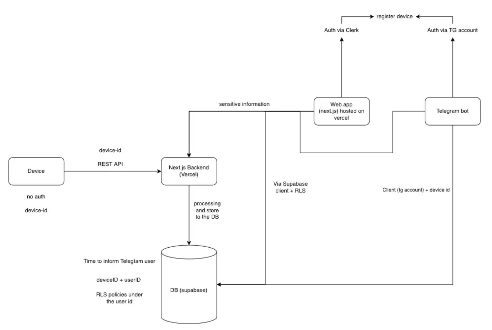

# Step 3 — Scope / MVP

## In Scope

### ESP32 Firmware
- Read BME280 sensor: temperature, humidity, atmospheric pressure
- Read anemometer via Hall sensor (A3144): wind speed
- Read wind vane via rotary encoder (KY-040): wind direction
- Read rain gauge via Hall sensor (A3144): precipitation (rain only)
- Obtain timestamps via NTP
- Send readings to Next.js backend over HTTPS with `device-id` header (no user auth on device)

### Backend (Next.js API routes — hosted on Vercel)
- Receive readings from ESP32, validate `device-id`, persist to Supabase
- Handle device registration (link `device-id` to `user-id`) from both the web app and the Telegram bot
- Handle sensitive operations from the web app that must not go client-side directly to Supabase

### Web App (Next.js frontend — hosted on Vercel)
- Authentication via Clerk
- Device registration flow: user links their ESP32 device-id to their account
- Real-time display of all sensor readings
- Historical charts for each parameter: last 24 h / 7 days / 30 days
- Data export: CSV with selectable date range
- Reads data directly from Supabase via Supabase JS client (RLS enforces user-scoped access)

### Telegram Bot (TypeScript)
- Authentication via Telegram account
- Device registration flow: user links their ESP32 device-id via bot
- `/current` command — returns the latest readings on demand
- Scheduled alerts: user-configurable time slots and days of the week (multiple per day allowed)

### Database (Supabase)
- `users` — linked to Clerk user ID or Telegram account
- `devices` — maps `device_id` to `user_id`
- `readings` — sensor data rows, scoped to `device_id`
- `schedules` — alert time slots per user
- Row Level Security (RLS) policies: users access only their own device data

### Infrastructure
- Monorepo with two apps: `web` (Next.js), `bot` (TypeScript)
- Shared `packages/db` (Prisma + Supabase)
- Next.js hosted on Vercel; bot hosted separately (e.g. Railway or VPS)

---

## System Architecture Overview

**Key data flow rules:**
- **Device → Backend → DB**: all sensor writes go through the Next.js backend; the device has no direct DB access.
- **Web app → Supabase directly** (via Supabase JS client + RLS) for all reads. Sensitive writes (device registration) route through the Next.js backend.
- **Telegram bot → Supabase directly** (using TG account identity + device id + RLS) for all reads. Registration routes through the Next.js backend.
- **RLS is the access-control layer** for all direct Supabase access — enforces that each user can only see their own device's data.

---

## Out of Scope

- LoRa / cellular fallback connectivity (WiFi only)
- Support for multiple simultaneous weather stations per user
- Mobile app (iOS / Android)
- Home-automation integrations (HomeKit, Google Home, MQTT)
- Weather forecasting
- Public API for third-party consumers
- Calibration tools or certified meteorological accuracy
- Snow measurement (rain only; post-MVP)

---

## MVP

The smallest version that proves the core flow end-to-end:

1. **ESP32** reads the BME280 (temperature, humidity, pressure — no wind or rain yet) and POSTs readings to the backend over HTTPS with its `device-id`.
2. **Next.js API route** validates the device-id, stores readings in Supabase.
3. **Web app** (Next.js + Clerk auth) shows current readings and a 24-hour chart; user must be logged in and have registered their device.
4. **Telegram bot** responds to `/current` and sends a scheduled daily alert at one configurable time.

Wind / rain sensors, 7-day / 30-day charts, CSV export, and full multi-slot scheduling are confirmed in scope but deferred to the phase after MVP is working end-to-end.

### Acceptance Criteria
- A new reading appears on the dashboard within 15 s of the ESP32 sending it
- `/current` responds within 2 s
- Scheduled alert fires within 1 min of the configured time
- Data in Supabase is not accessible to other users (RLS verified)
- Data survives a Vercel cold start
