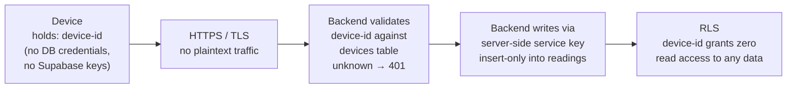
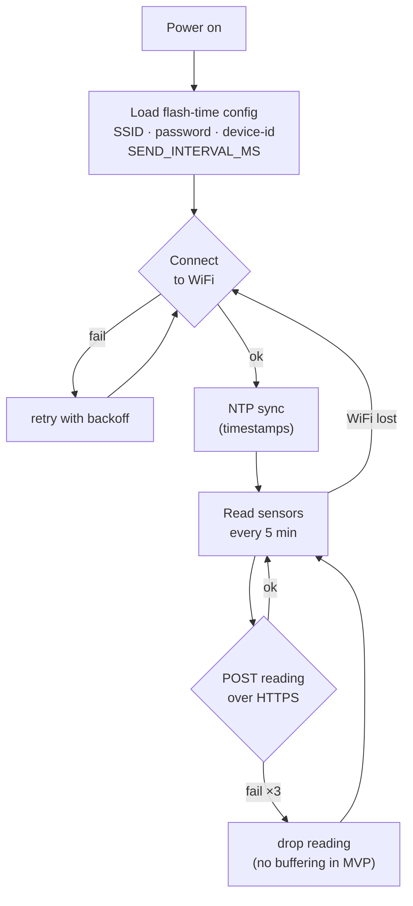
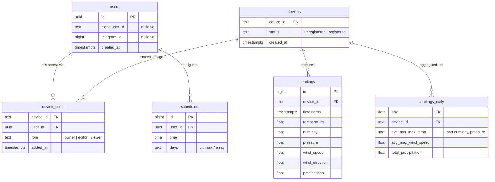
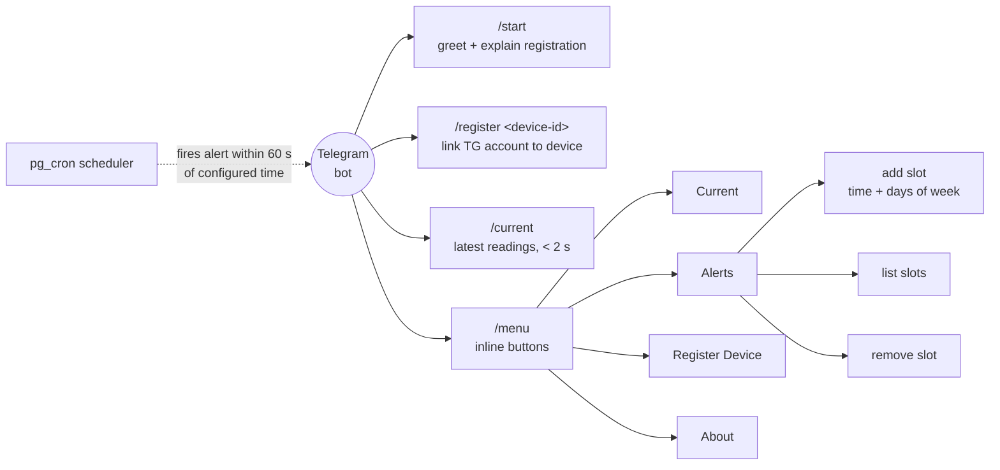
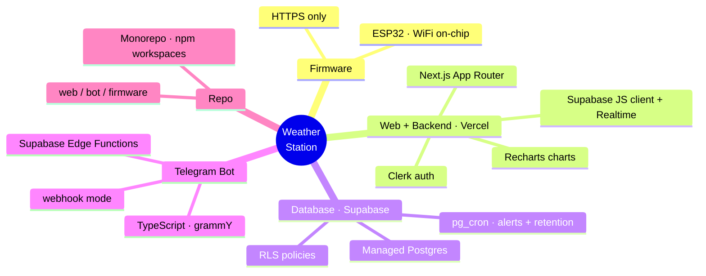

# Step 5 & 6 — Architecture & Tech Stack

## System Architecture

---

## Device → DB: Security

The device never talks to the DB directly — its only path is `POST /api/readings` on the backend.

- `device-id` is an opaque UUID generated at flash time (derived from the ESP32 chip ID) — effectively a bearer credential, unguessable.
- The device can only **write**; it cannot read anything back. Even a leaked device-id exposes no user data — worst case is spoofed readings for that one device.
- Post-MVP hardening (if needed): per-device secret + HMAC signature over the payload, so a sniffed device-id alone is useless.

---

## Device WiFi Connection (Boot Process)

WiFi credentials and device-id are baked in at **flash time** — no pairing screen or captive portal in MVP (PRD F7).

Post-MVP options: captive-portal setup (WiFiManager-style AP) for changing WiFi without reflashing; LittleFS local buffering for offline gaps (PRD OQ2).

---

## Data Model

---

## Telegram Bot Commands

---

## Tech Stack

