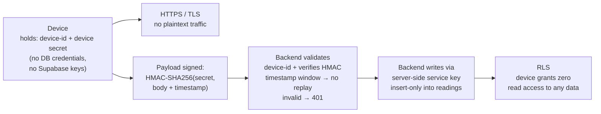
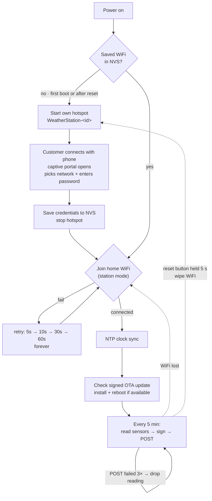
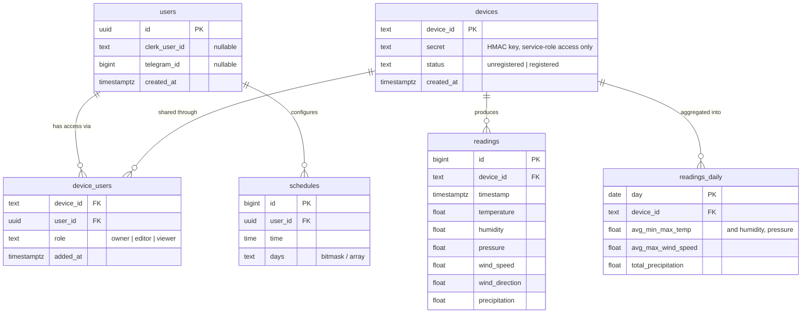
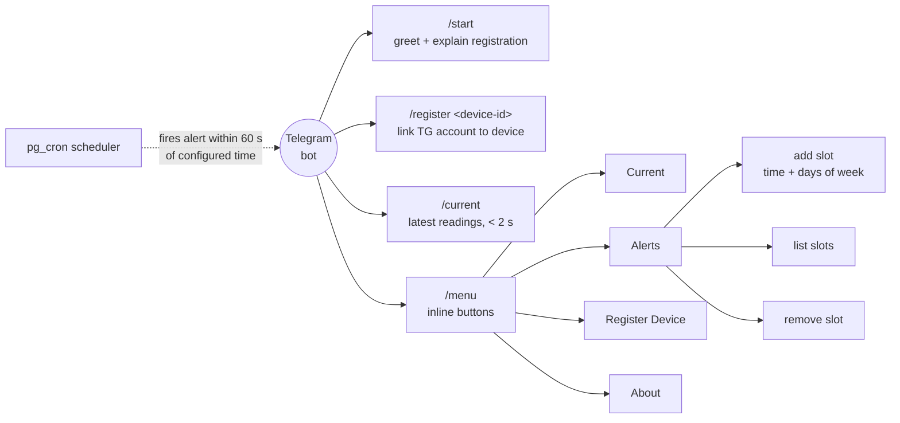
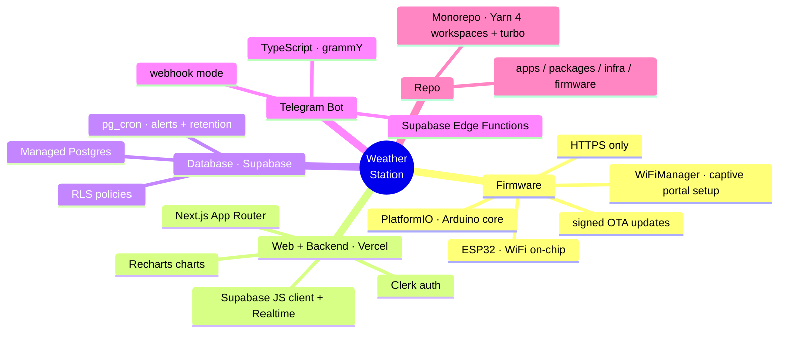

# Step 5 & 6 — Architecture & Tech Stack

## System Architecture

---

## Device → DB: Security

The device never talks to the DB directly — its only path is `POST /api/v1/readings` on the backend.

- Every device is flashed with two values: a public `device-id` (printed on the label, used for registration) and a **`device_secret`** (never leaves the device, never shown to the user).
- Each `POST /api/v1/readings` carries an **HMAC-SHA256 signature** of the payload + timestamp, computed with the secret. The backend recomputes and compares; the timestamp window rejects replayed requests.
- The `v1` in that path is a **major** version and moves only on a breaking contract change. Devices are flashed with the full URL, so backwards-compatible revisions are published as an OpenAPI `info.version` semver bump (`1.0.1`) and never move the path. Docs for each served version live at `/api/{version}/docs`.
- The device-id on the label is therefore **not** a credential — knowing it lets you register the device, but not spoof its readings.
- The device can only **write**; it cannot read anything back. No Supabase keys on the device — the backend writes server-side.

---

## Device WiFi Connection (Provisioning + Boot Process)

**Hard constraint:** this is a physical device shipped to a customer. Once it leaves us, we cannot re-flash it, and we cannot ask the customer to send it back. Two consequences, both **in MVP**:

1. **WiFi credentials are entered by the customer, not flashed by us** — we don't know their network at manufacture time, and they may change routers later. Setup is a captive portal (WiFiManager-style).
2. **The very first shipped firmware includes OTA updates** — it's the only way to fix a bug in the field.

Only the identity is flashed at manufacture: `device-id` (printed on the label) + `device_secret`. No network config in firmware.

**Customer setup (first boot, or after WiFi reset):**

1. Customer powers on the device. It has no saved WiFi, so it starts as its own access point: hotspot named `WeatherStation-<id>`.
2. Customer connects to that hotspot with a phone; the setup page opens automatically (captive portal).
3. The page lists nearby WiFi networks; customer picks their home network and enters its password.
4. Device saves the credentials to flash storage (NVS — survives power loss), stops the hotspot, and joins the home network.
5. Done — from now on every boot goes straight to the normal cycle below. A reset button (hold 5 s) wipes saved WiFi and returns to step 1 (e.g. customer moves or changes router).

**Normal operation (every boot after setup):**

1. Load saved WiFi credentials from NVS; load `device-id` + `device_secret` from firmware.
2. Join the home network (station mode). On failure — retry with increasing delay (5 s → 10 s → 30 s → 60 s, forever). The device never bricks; readings just pause until WiFi is back.
3. Sync clock via NTP (needed for reading timestamps and the HMAC anti-replay window).
4. Check for a signed OTA firmware update; install and reboot if one is published.
5. Main loop: every 5 minutes read sensors → sign payload → POST over HTTPS. Failed POST retries 3×, then that reading is dropped (no buffering in MVP — PRD OQ2). WiFi lost → back to step 2.

---

## Data Model

---

## Telegram Bot Commands

---

## Tech Stack

